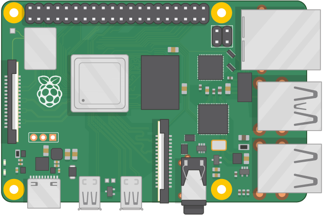
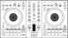

<h1 align="center">SegensDJ</h1>

<p align="center">
  Segensworte mischen wie ein DJ —<br>
  ein Raspberry Pi mit DJ-Controller für die Ausstellung „Interreligiöse Segensräume“.
</p>

<p align="center">
  
  
</p>

## Worum es geht

Segen ist in vielen Religionen ein Wort, das man jemandem zuspricht. Der
SegensDJ lässt Besucher:innen einer Ausstellung damit spielen: Auf einem
DJ-Controller liegen gesprochene Segensworte, Klänge und Geräusche aus
verschiedenen Traditionen, die sich übereinanderlegen, ausblenden und neu
mischen lassen.

Das Repository enthält ein fertiges Image für den Raspberry Pi, auf dem die
DJ-Software Mixxx mit passender Einrichtung für den Controller läuft, dazu
die Klangdateien.

## Funktionen

- **Fertiges Image** — auf die SD-Karte schreiben, starten, auflegen
- **36 Klangdateien** — Segensworte, Töne und Geräusche in `Samples/`
- **Controller vorbereitet** — Mixxx 2.3.3 mit Zuordnung für den
  Pioneer DDJ-SB3
- **Fernzugriff** — SSH, VNC und Dateifreigabe (SMB) für die Wartung

## Installation

**Hardware.**
- Raspberry Pi 4 mit 8 GB RAM
- Pioneer DDJ-SB3
- Boxen oder Verstärker, über 3,5-mm-Klinke am Pi oder über die Soundkarte
  des Controllers

<p float="left">
&nbsp;&nbsp;&nbsp;&nbsp;&nbsp;&nbsp;&nbsp;&nbsp;

</p>

**Image schreiben.** Wer das Flashen von SD-Karten kennt, nimmt den
gewohnten Weg. Sonst:

1. [balenaEtcher](https://etcher.balena.io) installieren.
2. [`SegensDJ-Pi.zip`](SegensDJ-Pi.zip) herunterladen (liegt in Git LFS).
3. SD-Karte anschließen, Etcher öffnen, „Flash from file“ und die Datei
   wählen.
4. SD-Karte wählen, bestätigen, dass nichts Wichtiges darauf liegt, und
   „Flash“ klicken.

**WLAN einrichten.** Nach dem Schreiben erscheint die Partition `boot`
(sonst die Karte einmal aus- und wieder einstecken). Dort die Datei
`wpa_supplicant.conf` anlegen:

```
country=DE
ctrl_interface=DIR=/var/run/wpa_supplicant GROUP=netdev
update_config=1
network={
       ssid="DEINE WLAN SSID"
       psk="DEIN PASSWORT"
       key_mgmt=WPA-PSK
}
```

Dann die Karte in den Pi stecken und starten; er meldet sich im WLAN.

**Zugriff.** Für beide Wege braucht es die IP-Adresse des Pi.

- **SSH:** `ssh pi@<IP>`, Benutzer `pi`, Passwort `mixxx`.
- **VNC:** bei Bedarf per SSH starten mit
  `sudo systemctl start vncserver@1.service`, dann im VNC-Client
  `<IP>:5901` mit dem Passwort `mixxxpi`. Geeignet sind etwa
  [VNC Viewer](https://www.realvnc.com/de/connect/download/viewer/),
  [TightVNC](https://www.tightvnc.com/download.php) oder
  [UltraVNC](https://uvnc.com/).

**Bitte nach der Einrichtung beide Passwörter ändern** (`passwd` und
`vncpasswd`). Es sind die Vorgaben des Images und damit öffentlich.

## Bekannte Eigenheiten

- In `/home/pi/.mixxx/controllers/Pioneer-DDJ-SB3-scripts.js` ist Zeile 981
  auskommentiert, weil Mixxx sonst beim Start einen Fehler meldet.
  Funktioniert das Deck nicht richtig, ist das die erste Stelle zum
  Nachsehen.
- Startet der VNC-Server automatisch mit, erkennt Mixxx das Deck nicht.
  Deshalb wird er nur bei Bedarf von Hand gestartet.

## Versionen

Das Image ist als [Release 0.1.0-beta](https://github.com/Revisor01/SegensDJ/releases)
markiert. Gegenüber dem Ausgangsimage enthält es die Systemupdates vom
08.11.2022, Mixxx 2.3.3 (wegen des Controllers), VNC-Server,
SMB-Freigabe und einen Zeitserver. Was sich wann geändert hat, steht in
[CHANGELOG.md](CHANGELOG.md).

## Aufbau

```
SegensDJ
├── SegensDJ-Pi.zip   — fertiges Image für die SD-Karte (Git LFS)
├── Samples/          — Klangdateien (WAV)
└── docs/             — Bilder für diese Seite
```

## Mitmachen

Fehlermeldungen und Vorschläge sind willkommen — gern als
[Issue](https://github.com/Revisor01/SegensDJ/issues). Sicherheitslücken
bitte vertraulich melden, wie in [SECURITY.md](SECURITY.md) beschrieben.
Die Grundsätze für Beiträge stehen in [CONTRIBUTING.md](CONTRIBUTING.md).

## Lizenz

[MIT](LICENSE). Das Image basiert auf
[fayaaz/mixxx-pi-gen](https://github.com/fayaaz/mixxx-pi-gen).

## Kontakt

Pastor Simon Luthe · [mail@simonluthe.de](mailto:mail@simonluthe.de) ·
[simonluthe.de](https://simonluthe.de)
